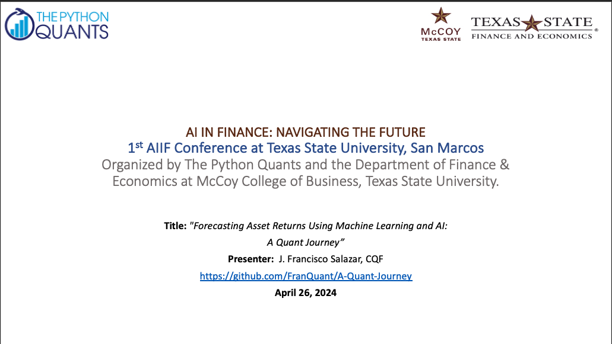

# Forecasting Asset Returns Using Machine Learning and Artificial Intelligence

    [](LICENSE)



### Conference Presentation

- **Title:** A Quant Journey
- **Presenter:** J. Francisco Salazar
- **Event:** AI in Finance: Navigating the Future — Inaugural Artificial Intelligence in Finance Conference
- **Date:** April 26–27, 2024

- 📄 [Original Conference Slides (PDF)](presentations/AI%20in%20Finance-%20Navigating%20the%20Future.pdf)
- ▶️ [Original Conference Recording (YouTube)](https://www.youtube.com/watch?v=viCfp-AWUvQ)

## Project Overview

*A Quant Journey* explores machine learning for stock market forecasting using a decade of daily financial data. It compares classification models and hypothetical trading strategies against an SPY benchmark, examining predictive accuracy, overfitting, and transaction costs.


## Research Notebooks

The teaching sequence follows one dated prediction experiment from market observations to independently reconciled portfolios.

| Notebook | Research focus |
|---|---|
| [01 — Understand financial market data](notebooks/teaching/01_understand_the_data.ipynb) | Observed sessions, missing prices, returns and volatility. |
| [02 — Explore candidate features](notebooks/teaching/02_construct_candidate_features.ipynb) | Trailing indicators, train-fitted PCA and clustering. |
| [03 — Test predictive value](notebooks/teaching/03_test_predictive_value.ipynb) | Seven fixed SPY classifiers and a training-majority baseline. |
| [04 — From predictions to portfolio accounting](notebooks/teaching/04_predictions_to_portfolio_accounting.ipynb) | Next-close positions, fees and a self-financing ledger. |
| [05 — Portfolio simulation, reconciliation and analytics](notebooks/teaching/05_vectorbt_portfolio_reconciliation.ipynb) | Independent VectorBT fills, reconciliation and QuantStats analytics. |

## Getting Started

Clone the repository and reproduce the teaching workflow using Python 3.11.

```bash
git clone https://github.com/FranQuant/a-quant-journey.git
cd a-quant-journey

python3.11 -m venv .venv
.venv/bin/python -m pip install -r requirements.txt
.venv/bin/python -m ipykernel install --sys-prefix --name a-quant-journey
.venv/bin/python scripts/execute_teaching_notebooks.py
```

The default command executes the four base notebooks. The fifth uses a separate analytics kernel. The teaching guide covers the complete run, offline HTML publication and scientific references. [Teaching guide](notebooks/teaching/README.md)

## License

This project's source code is available under the [MIT License](LICENSE). Third-party data and conference materials may be subject to separate terms.

## Disclaimer

This repository is provided for educational and research purposes only and does not constitute investment advice. Historical results and hypothetical backtests do not guarantee future performance.
