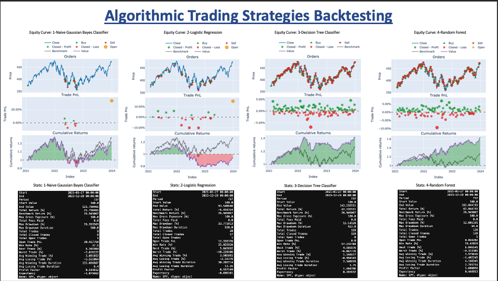

# Forecasting Asset Returns Using Machine Learning and Artificial Intelligence

      [](LICENSE)


### Conference Presentation

- **Title:** A Quant Journey
- **Presenter:** J. Francisco Salazar
- **Event:** AI in Finance: Navigating the Future — Inaugural Artificial Intelligence in Finance Conference
- **Date:** April 26–27, 2024

- 📄 [Original Conference Slides (PDF)](presentations/AI%20in%20Finance-%20Navigating%20the%20Future.pdf)
- ▶️ [Original Conference Recording (YouTube)](https://www.youtube.com/watch?v=viCfp-AWUvQ)

## Project Overview

*A Quant Journey* is a reproducible quantitative finance research project exploring machine learning for financial market forecasting and systematic investment strategies.

Originally presented at the inaugural Artificial Intelligence in Finance Conference in April 2024, the project has evolved into a modular, five-notebook research workflow covering financial data analysis, feature engineering, machine learning, execution-aligned portfolio accounting, and independent backtesting reconciliation.

The framework integrates pandas, NumPy, scikit-learn, VectorBT and QuantStats, emphasizing chronological validation, causal feature construction, transaction costs, financial performance analytics and reproducibility.



*Historical strategy results from the April 2024 conference presentation.*

## Research Notebooks

The current teaching sequence follows a separate SPY prediction experiment from market observations to independently reconciled portfolios.

| Notebook | Research focus |
|---|---|
| [01 — Understand financial market data](notebooks/teaching/01_understand_the_data.ipynb) | Observed sessions, missing prices, returns and volatility. |
| [02 — Explore candidate features](notebooks/teaching/02_construct_candidate_features.ipynb) | Trailing indicators, train-fitted PCA and clustering. |
| [03 — Test predictive value](notebooks/teaching/03_test_predictive_value.ipynb) | Seven fixed SPY classifiers and a training-majority baseline. |
| [04 — From predictions to portfolio accounting](notebooks/teaching/04_predictions_to_portfolio_accounting.ipynb) | Next-close positions, fees and a self-financing ledger. |
| [05 — Portfolio simulation, reconciliation and analytics](notebooks/teaching/05_vectorbt_portfolio_reconciliation.ipynb) | Independent VectorBT fills, reconciliation and QuantStats analytics. |

## Getting Started

Clone the repository to explore the research notebooks and reproduce the quantitative research workflow in Python.

```bash
git clone https://github.com/FranQuant/a-quant-journey.git
cd a-quant-journey
```

The notebooks can be explored using JupyterLab or Google Colab, with the appropriate research environment configured.

For dependency installation, environment configuration and execution of the complete five-notebook sequence, refer to the [Teaching and Reproduction Guide](notebooks/teaching/README.md).

## License

This project's source code is available under the [MIT License](LICENSE). Third-party data and conference materials may be subject to separate terms.

## Disclaimer

This repository is provided for educational and research purposes only and does not constitute investment advice. Historical results and hypothetical backtests do not guarantee future performance.
